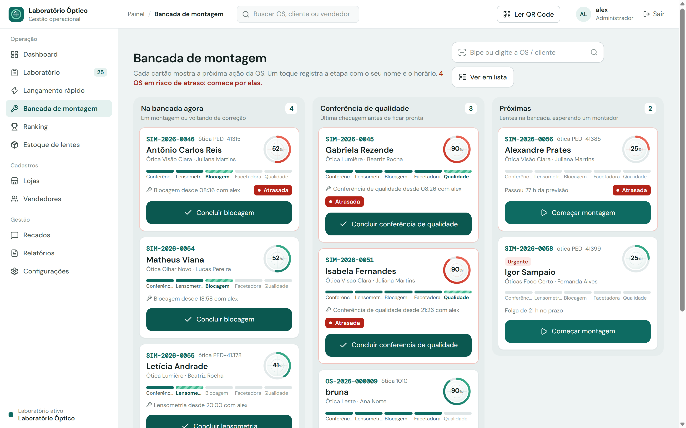
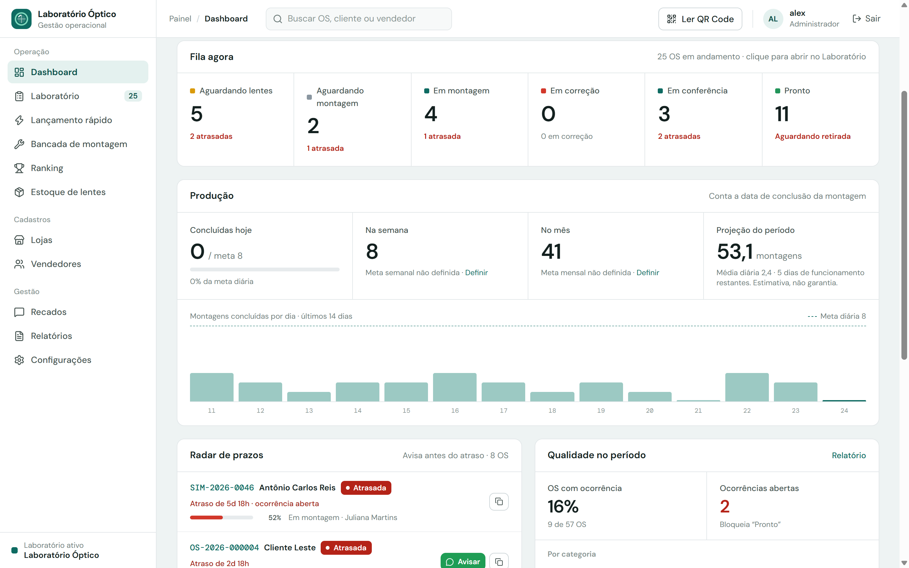
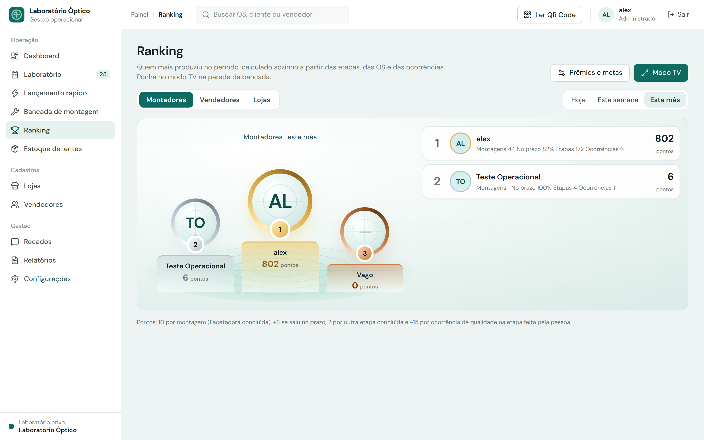
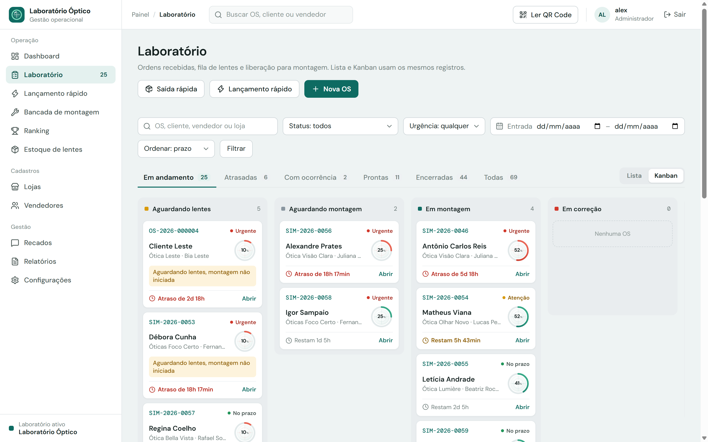
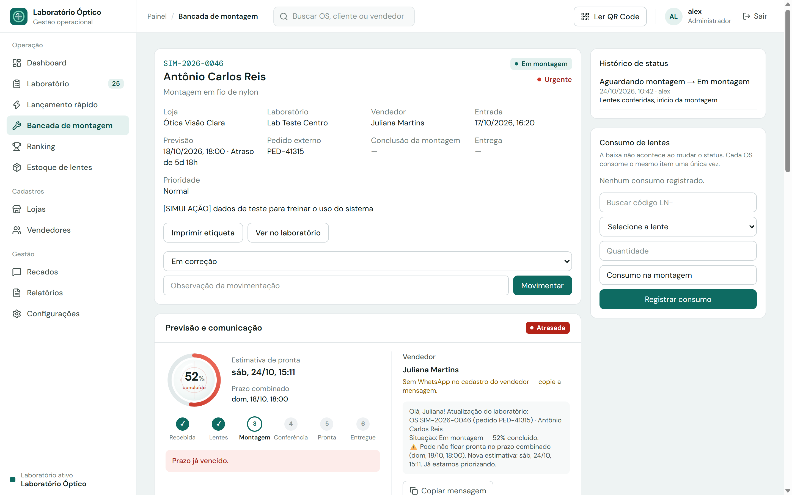
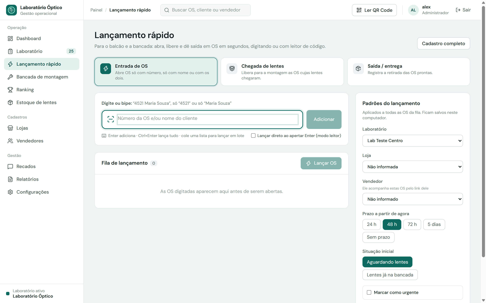
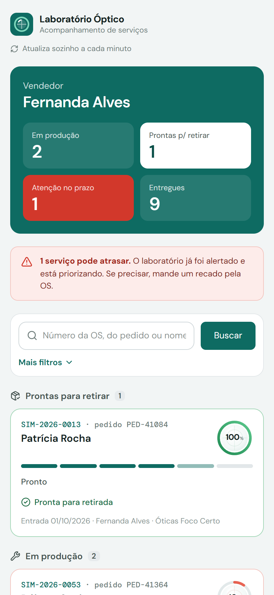
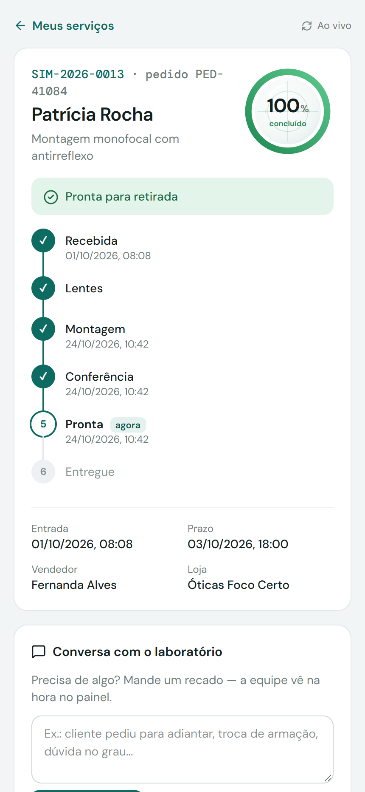
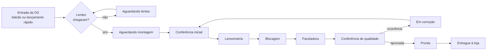
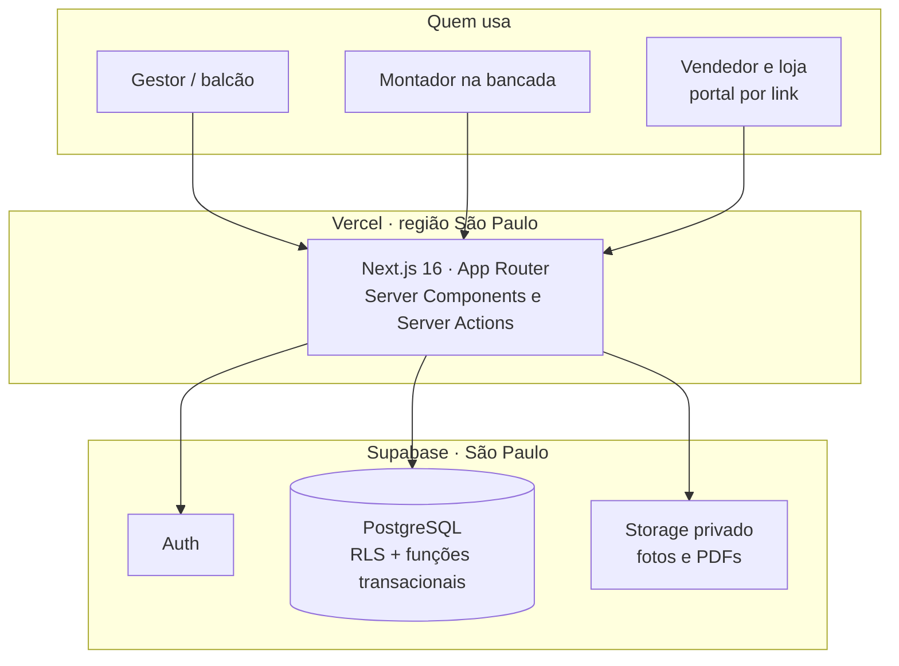

<div align="center">

# Laboratório Óptico · OticaHub Lab

**Sistema de gestão da produção para laboratórios de montagem óptica.**
Da entrada da ordem de serviço até a entrega na loja, com bancada por etapas, previsão de atraso e acompanhamento em tempo real para vendedores e óticas.

[](https://github.com/alexferreiraindustrial-hue/laboratorio-optico/actions/workflows/ci.yml)


**[lab.oticahub.com](https://lab.oticahub.com)**

</div>

---

## O problema

Em um laboratório de montagem, a ordem de serviço passa por várias mãos: o vendedor na ótica, o balcão que recebe, quem espera as lentes, o montador em cada máquina e a conferência final. Sem um sistema, o controle fica em papel e WhatsApp: ninguém sabe em que etapa o óculos está, o atraso só aparece quando o cliente reclama e o vendedor liga várias vezes para perguntar.

## A solução

Um painel único, pensado para a rotina da bancada:

- **Lançamento rápido** — a OS entra em segundos só com o número, só com o nome do cliente ou com os dois. Aceita leitor de código de barras e lista colada do WhatsApp.
- **Bancada de montagem** — cada OS mostra a **próxima ação** em um botão grande (Iniciar blocagem, Concluir facetadora, Marcar como pronta), registrando quem fez e quando em cada uma das cinco etapas: conferência inicial, lensometria, blocagem, facetadora e conferência de qualidade.
- **Previsão de atraso** — o sistema calcula o progresso de cada OS e avisa **antes** do prazo vencer. O gestor vê o radar e manda a atualização para o vendedor pelo WhatsApp com a mensagem já escrita.
- **Portal do vendedor e da loja** — um link seguro, sem senha, onde o vendedor acompanha os serviços em seu nome com % de progresso, linha do tempo, previsão e recados para o laboratório.
- **Qualidade** — ocorrências por etapa (lente riscada, erro de blocagem, grau divergente…) que bloqueiam a OS de ficar pronta até serem tratadas.
- **Ranking da produção** — pódio de montadores, vendedores e lojas com metas, prêmios e **modo TV** para a parede do laboratório.
- **Gestão** — dashboard de fila e produção, metas diária/semanal/mensal, estoque de lentes por grau com QR Code e relatórios em CSV.

## Engenharia de Produção aplicada

Este projeto nasceu como um trabalho de **melhoria contínua** dentro de um laboratório real. Cada funcionalidade é uma ferramenta de gestão da produção transformada em software:

| Ferramenta | No sistema |
| --- | --- |
| **Kanban puxado** | Fluxo da OS em colunas, puxado pelo prazo, com **limite WIP** por coluna que fica vermelho quando o fluxo trava |
| **Gestão visual / Andon** | Radar de prazos, alerta de risco e ranking em modo TV |
| **Trabalho padronizado** | Cinco etapas fixas na bancada, com a próxima ação em um toque |
| **Poka-yoke** | A OS não fica pronta sem as 5 etapas concluídas e sem ocorrência aberta |
| **Jidoka / qualidade na fonte** | Ocorrência registrada na etapa onde aconteceu, bloqueando o avanço |
| **5S** | **Auditoria 5S** com checklist de 20 itens por área, nota de 0 a 5 por senso, radar e evolução semanal |
| **Kaizen / PDCA** | Quadro de ideias da equipe em Planejar → Executar → Verificar → Padronizar, com **5 Porquês** e matriz impacto × esforço |
| **Lean Six Sigma** | Nível sigma (DPMO), FPY, OTD, lead time, Lei de Little, takt time, **Pareto 80/20** e **carta de controle u**, organizados no ciclo DMAIC |
| **Teoria das Restrições** | Tempo de ciclo por etapa da bancada e identificação automática do gargalo |

📄 O caso completo, no roteiro **DMAIC** (Definir, Medir, Analisar, Melhorar e Controlar), está em **[docs/estudo-de-caso.md](docs/estudo-de-caso.md)**.

## Telas

<table>
  <tr>
    <td width="50%"><br><sub><b>Bancada de montagem</b> — próxima ação de cada OS e as cinco etapas</sub></td>
    <td width="50%"><br><sub><b>Dashboard</b> — fila (WIP), produção × meta, radar de prazos e qualidade</sub></td>
  </tr>
  <tr>
    <td><br><sub><b>Ranking</b> — gestão à vista com pódio, metas e modo TV</sub></td>
    <td><br><sub><b>Kanban</b> — fluxo da OS puxado pelo prazo</sub></td>
  </tr>
  <tr>
    <td><br><sub><b>Ordem de serviço</b> — progresso, previsão e comunicação com o vendedor</sub></td>
    <td><br><sub><b>Lançamento rápido</b> — entrada, chegada de lentes e saída em lote</sub></td>
  </tr>
</table>

<p align="center">
  
  &nbsp;&nbsp;
  
  <br><sub><b>Portal do vendedor</b> (celular) — acompanha os próprios serviços sem precisar de senha</sub>
</p>

> As telas usam dados de simulação (OS `SIM-…`).

## Fluxo de uma ordem de serviço



A cada passo o sistema recalcula o progresso e a previsão de conclusão. Se a previsão passa do prazo combinado, a OS entra no radar como **risco de atraso** e o vendedor pode ser avisado na hora.

## Arquitetura



Decisões de projeto que valem destacar:

- **Regras críticas no banco**: mudança de status, avanço de etapa, ocorrências e estoque passam por funções SQL transacionais. Uma OS só fica *Pronta* com as cinco etapas concluídas e sem ocorrência aberta, mesmo que alguém tente pela API.
- **Row Level Security** em todas as tabelas, com cinco perfis (administrador, gestor, montador, estoquista e consulta). Esconder um botão não é a proteção; o banco recusa a operação.
- **Portal sem senha e sem vazamento**: o vendedor recebe um token próprio; o banco guarda só o hash, com limite de requisições e revogação.
- **Regras de negócio puras e testadas** em `src/lib/domain` (previsão, ranking, lançamento rápido, transições de status), com testes automatizados.
- **Desempenho**: funções na mesma região do banco (`gru1`), carregamento instantâneo com esqueleto de tela e consultas agrupadas.

## Tecnologias

| Camada | Uso |
| --- | --- |
| **Next.js 16** (App Router), **React 19**, **TypeScript** | Interface e servidor |
| **Tailwind CSS 4**, lucide-react, dnd-kit | Visual, ícones e Kanban |
| **Supabase**: PostgreSQL, Auth, Storage | Dados, segurança (RLS) e arquivos |
| **Zod** | Validação de formulários |
| **Vitest** | Testes das regras de negócio |
| **Vercel** + GitHub Actions | Deploy contínuo e verificação a cada push |

## Rodando localmente

```bash
git clone https://github.com/alexferreiraindustrial-hue/laboratorio-optico.git
cd laboratorio-optico
npm install
cp .env.example .env.local   # preencha com as chaves do seu projeto Supabase
npm run dev
```

O passo a passo completo (migrations, primeiro administrador, permissões e publicação) está em **[docs/INSTALACAO.md](docs/INSTALACAO.md)**.

```bash
npm test            # regras de negócio
npm run typecheck   # TypeScript
npm run lint        # ESLint
npm run build       # build de produção
```

## Roadmap

O desenvolvimento segue em ciclos curtos. As próximas entregas estão nas [Issues](https://github.com/alexferreiraindustrial-hue/laboratorio-optico/issues) e o histórico de cada versão em [CHANGELOG.md](CHANGELOG.md). Destaques:

- [ ] Notificação automática ao vendedor (WhatsApp API) quando a OS ficar pronta ou entrar em risco
- [ ] Tempo médio por etapa e por montador (gargalos da bancada)
- [ ] Aplicativo instalável (PWA) para tablet na bancada
- [ ] Integração com sistemas de venda das óticas para importar pedidos
- [ ] Multi-laboratório com faturamento por loja

## Autor

**Alex Ferreira** — estudante de **Engenharia de Produção** e Técnico em Óptica.

Não sou programador de formação: uso a **Inteligência Artificial como ferramenta de engenharia** para transformar problemas reais de gestão em soluções que funcionam no dia a dia. Eu defino o processo, as regras e os indicadores com base em Lean, Kanban, 5S e Six Sigma; a IA me ajuda a construir, conectando as ferramentas da operação por API e MCP, com automações em n8n e integração com CRM e WhatsApp; e a validação acontece no chão do laboratório. O sistema segue em melhoria contínua com uso real.

[LinkedIn](https://www.linkedin.com/in/antonio-alex-silva-ferreira-65434a298/) · [antonio.oticahub.com](https://antonio.oticahub.com)

---

<sub>© 2026 Antonio Alex Silva Ferreira LTDA. Código publicado para consulta e portfólio — veja [LICENSE](LICENSE).</sub>
